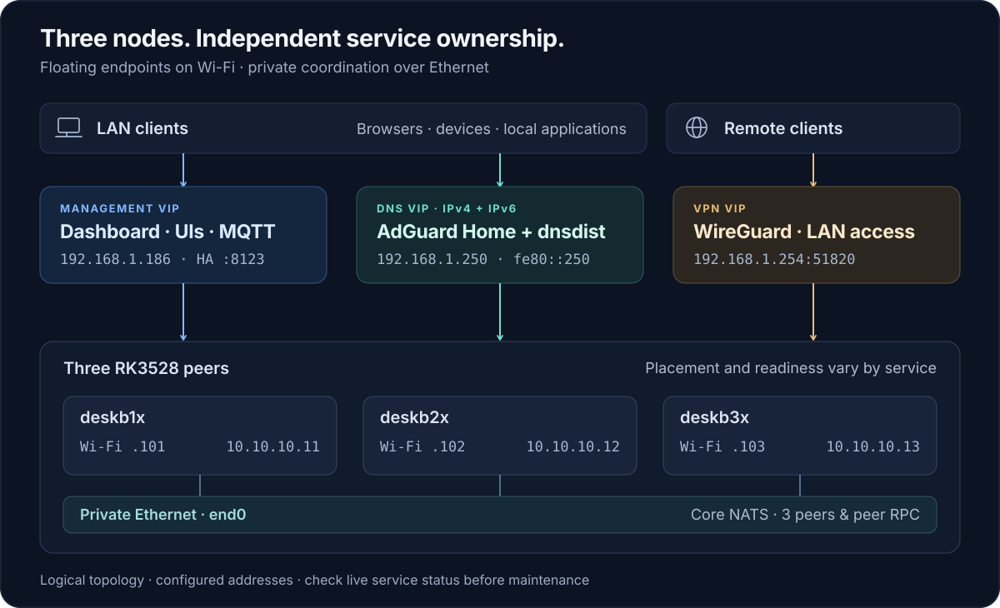

<h1 align="center">Xiaozhi Desk Cluster</h1>

<p align="center"><strong>Small hardware. Serious infrastructure.</strong></p>

<p align="center">
  Voice, home automation, cameras, and network services on three RK3528 boards.<br/>
  Managed with Ansible. Connected over private Ethernet. Built around explicit recovery.
</p>

<p align="center">
  <code>3 × RK3528</code> &nbsp;·&nbsp; <code>Debian ARM64</code> &nbsp;·&nbsp;
  <code>Ansible</code> &nbsp;·&nbsp; <code>Core NATS</code>
</p>

<p align="center">
  <a href="#architecture">Architecture</a> &nbsp;·&nbsp;
  <a href="#services">Services</a> &nbsp;·&nbsp;
  <a href="#getting-started">Getting started</a> &nbsp;·&nbsp;
  <a href="#operations">Operations</a> &nbsp;·&nbsp;
  <a href="#repository-layout">Repository layout</a>
</p>

---

One dashboard, three peers, and independent recovery paths for the services that
run your home. This repository contains a hardware-specific reference deployment,
from host configuration to service recovery.

## Architecture

<picture>
  <source media="(max-width: 640px)" srcset="docs/assets/architecture-mobile.svg"/>
  
</picture>

Wi-Fi carries management and Internet access. The `end0` Ethernet fabric carries
private cluster traffic, including Core NATS and peer RPC. All three nodes are
peers; placement preferences and readiness determine service ownership.

The topology describes repository configuration. Live owners, revisions, and
health must be read from the running cluster.

- **Independent ownership.** Management, DNS, and VPN have separate floating
  endpoints. Stateful workloads elect their own owners.
- **Recovery with defined boundaries.** Certified checkpoints, fenced runtimes,
  and per-service recovery procedures make the retained state explicit.
- **Scoped changes.** Deploy a feature, refresh a helper, or verify a service
  through its own playbook. Foundation convergence stays separate.

<details>
<summary><strong>What failover means for each workload</strong></summary>

Recovery depends on the workload and the state it owns:

| Workload | Recovery model | Boundary to understand |
| --- | --- | --- |
| Management, DNS, VPN | Independent floating endpoints and health checks | Connections and VPN sessions can be interrupted |
| Network discovery | Majority lease, certified checkpoints, warm replicas | Inventory freshness and checkpoint durability are separate |
| Home Assistant | Single-active Core restored from a certified snapshot | Unsynced changes can be lost; takeover includes a cold start |
| Cameras | Per-camera owners and fenced SDK work | Admitted playback can survive Core loss; active downloads do not migrate across camera owners |
| Voice | Distributed workers and session-bound cores | In-flight conversations are not replayed after node loss |
| Monitoring | Independent hubs with shared configuration | Metric history remains local to each hub |

</details>

## Services

The management endpoint hosts the dashboard and service links. Addresses and
routes below are the configured examples; the management VIP comes from Cloud
desired state.

| Service | What it provides | Guide |
| --- | --- | --- |
| **Xiaozhi** · `/xiaozhi/` | Shared settings, opt-in ASR/LLM/TTS workers, device tools, and Vision | [Runtime & deployment](docs/XIAOZHI_RUNTIME.md) |
| **DNS** · `.250:53` | AdGuard Home, dnsdist, real-client visibility, and paired IPv4/IPv6 endpoints | [DNS](docs/DESK_DNS.md) · [IPv6](docs/DESK_DNS_IPV6.md) |
| **VPN** · `/vpn/` | WireGuard HA, replicated client management, and owner-only DDNS | [Transport](docs/DESK_VPN.md) · [UI](docs/DESK_VPN_UI.md) |
| **Network** · `/network/` | NetAlertX inventory, distributed ARP/mDNS scans, and Rust checkpoint workers | [Discovery & recovery](docs/DESK_NETWORK.md) |
| **Home Assistant** · `:8123` | Native Core, manual online configuration sync, and certified recovery | [Core lifecycle](docs/HOME_ASSISTANT.md) |
| **Cameras** · native HA UI | Live relays, selected owner-side recordings, thumbnails, and browser playback | [Capabilities & authority](docs/CAMERA_MEDIA.md) |
| **Monitoring** · `/monitor/` | Three Beszel hubs, shared settings, and node/service telemetry | [Monitoring](docs/DESK_MONITORING.md) |
| **NTFY** · `:2586` | Native ntfy-rs, quorum auth, static Web UI, and notifications in Pi Events | [Notifications & recovery](docs/DESK_NTFY.md) |
| **Dashboard** · `/` | Cluster topology, freshness-aware status, and confirmed maintenance actions | [Dashboard](docs/DESK_DASHBOARD.md) · [LAN UI](docs/DESK_UI.md) |
| **Displays** | Deskbox FD6551 indicators and a separate Raspberry Pi touchscreen client | [Node panel](docs/XIAOZHI_RUNTIME.md#fd6551-node-panel) · [Pi panel](docs/PI_PANEL.md) |

Internal messaging uses [Core NATS](docs/NATS.md). It carries RPC and streaming
control without JetStream persistence. The voice runtime source is maintained in
[xiaozhi-desk-robot-server](https://github.com/hudrucan/xiaozhi-desk-robot-server).

## Getting started

### 1. Inspect the deployment

```sh
git clone https://github.com/hudrucan/xiaozhi-desk-cluster.git
cd xiaozhi-desk-cluster
```

Review [inventory.ini](inventory.ini), [host_vars/](host_vars/), and
[group_vars/](group_vars/) against your hardware and network. Read the
[Wi-Fi driver requirements](docs/DESK_WIFI_DRIVER.md) before enabling movable
VIPs, and the [Xiaozhi deployment guide](docs/XIAOZHI_RUNTIME.md) before selecting
a voice runtime.

### 2. Prepare the prerequisites

- **Controller:** Ansible with `community.general`, SSH access to the nodes,
  and the build dependencies required by the selected feature.
- **Nodes:** three supported Debian ARM64 systems with Python 3.11, systemd,
  management connectivity, and a private Ethernet fabric.
- **Private inputs:** your encrypted `vars/vault.yml`, service credentials,
  and any existing keys, model assets, or recovery material required by the guide.
  Private inputs are not supplied by cloning this repository.

Run Ansible from the repository root so it loads [ansible.cfg](ansible.cfg).
The cluster inventory stays at root; `desk_repo_root` resolves local assets and
secret paths independently of the feature playbook's location.

### 3. Validate, then apply the foundation

```sh
ansible-playbook -i inventory.ini site.yml --syntax-check --ask-vault-pass
ansible-playbook -i inventory.ini site.yml --ask-vault-pass
```

[site.yml](site.yml) configures identity, networking, access, Wi-Fi, SSH, NATS,
workers, control planes, and management ingress. Optional services use their
own feature playbooks. Default workers are ping-only; provider execution requires
explicit configuration. Preserve your intended overrides on every convergence run.

For example, validate the Network entrypoint without deploying it:

```sh
ansible-playbook -i inventory.ini playbooks/network/network.yml --syntax-check
```

Pi deployment uses its own inventory:

```sh
ansible-playbook -i playbooks/pi-panel/inventory.ini playbooks/pi-panel/deploy.yml
```

## Operations

Start with the guide for the service being changed. It defines deployment order,
readiness gates, retained state, and recovery procedures.

| Task | Start here |
| --- | --- |
| Drain, maintain, or reboot a node | [Safe node maintenance](docs/CLUSTER_EXPERIENCE.md) |
| Sync or recover Home Assistant configuration | [Configuration durability](docs/HOME_ASSISTANT.md#config-durability-and-rpo) |
| Change camera authority or maintain media workers | [Camera deployment boundaries](docs/CAMERA_MEDIA.md#deployment-and-cleanup) |
| Recover rejected Cloud credentials | [OAuth recovery](docs/CLOUD_OAUTH.md) |
| Check VIP readiness or driver compatibility | [Healthchecks](docs/DESK_HEALTHCHECKS.md) · [Wi-Fi driver](docs/DESK_WIFI_DRIVER.md) |

The management UI assumes a trusted LAN/VPN. Its HTTP administration routes
include anonymous AdGuard access and Beszel auto-login; Home Assistant retains
native authentication. The private NATS fabric has no transport TLS. Keep these
boundaries in mind when adapting network exposure.

Preserve runtime state and existing keys during maintenance. Configuration in Git
expresses intended behavior; it does not establish current quorum or live health.

## Repository layout

```text
.
├── site.yml                    # Cluster foundation
├── bootstrap.yml               # Initial access
├── ansible.cfg                 # Shared role lookup
├── inventory.ini               # Three-node membership
├── playbooks/
│   ├── camera/                 # Media, ownership, observations, commands
│   ├── cluster/                # Wi-Fi driver and recurring healthchecks
│   ├── dashboard/              # Overview, maintenance timeline, panel API
│   ├── diagnostics/            # On-demand profiling
│   ├── dns/                    # Serving, policy sync, IPv6, verification
│   ├── homeassistant/          # Core lifecycle and checkpoints
│   ├── monitoring/             # Beszel hubs, shared config, UI
│   ├── network/                # Discovery, workers, warm replicas
│   ├── panel/                  # Deskbox FD6551 display
│   ├── pi-panel/               # Deploy, inventory, and Pi host vars
│   ├── ui/                     # Ingress and shared LAN routes
│   ├── vpn/                    # WireGuard, UI, DDNS, recovery
│   └── xiaozhi/
│       ├── core/
│       ├── workers/
│       ├── mqtt/
│       ├── settings/
│       └── source/
├── roles/                      # Implementation, templates, service tests
├── group_vars/                 # Shared configuration and repository anchor
├── host_vars/                  # Cluster node configuration
├── docs/                       # Current contracts and operations
├── examples/                   # Public configuration examples
├── scripts/                    # Setup and maintenance utilities
├── tests/                      # Layout and path-resolution checks
└── tools/                      # Rust checkpoint worker and build tooling
```

Service guides describe the supported state. Git retains development history.

## Validation and contributions

Use the Python environment that provides Ansible, PyYAML, and Jinja2 for the
offline layout checks:

```sh
python3 -m unittest discover -s tests -v
git diff --check
```

Each role and service guide provides its focused checks. A syntax check does not
contact nodes; `--check` may read installed state. Live failover, provider calls,
and hardware validation are separate operations.

Keep contributions scoped to a feature. Explain the behavior changed, the state
and compatibility assumptions it relies on, and the checks actually run. Include
recovery implications when changing ownership or persistence. Keep credentials
and private captures out of issues and patches.
