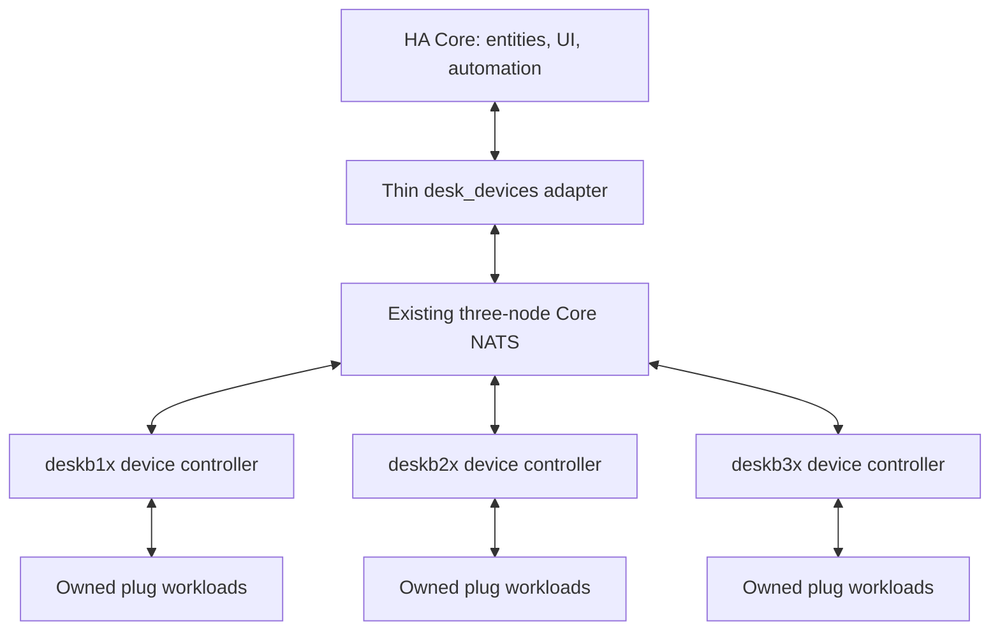

# Distributed device workers — design proposal

Research date: 2026-10-17. Inventory supplied by the user: two Xiaomi Mi Home
plugs and two Smart Life plugs, none added to Home Assistant. Exact models,
firmware, radio protocols and local-access credentials are not yet known.
This proposal has not changed the running cluster or actuated a device.

Tapo is the current higher-priority investigation. See
[remaining Tapo Core dependencies](TAPO_DISTRIBUTION_RESEARCH.md) before expanding
this general worker design to the lower-priority plugs.

## Intended boundary

Run vendor discovery/authentication, device sessions, polling, event handling and
commands outside Home Assistant Core. Spread device workloads across the three
existing nodes, with automatic takeover. Core exposes stable switch/sensor entities
and runs its existing UI, recorder and automations through one vendor-independent
adapter. This distributes device integrations; HA automations remain on the
single-active Core unless a separate automation runtime is designed later.

Placement in the diagram is illustrative. Four independent LAN plugs could spread
2/1/1, subject to reachability, headroom, driver compatibility and other owners.
Only the owner opens vendor sessions. Standbys vote and hold recovery configuration.
Healthy owners stay sticky rather than moving on every CPU fluctuation.

## Existing building blocks and limits

- `roles/desk_camera/files/controller.py` already elects independent media owners;
  `transport.py` shares bounded NATS connections and fleet status collection.
- `roles/desk_homeassistant/files/lease.py` supplies majority leases. Camera's
  `runtime.py` demonstrates independent BOOTTIME permit enforcement.
- The current NATS template explicitly configures Core NATS without JetStream.
  It supplies transport, not durable command storage or ownership by itself.
- Camera media workers do not distribute their upstream Tapo Control integration.
  The retired `desk_remote` pilot is not an installed framework to extend.
- Keep the new device adapter separate from the existing Core Health/backup
  component. A device command must not gain access to Core stop/handoff operations.

Reuse audited primitives through explicit dependencies; avoid a new consensus
algorithm, another broker, or a broad shared-framework rewrite as prerequisites.

## Candidate device drivers

| Inventory | First candidate | Information needed before choosing it |
| --- | --- | --- |
| Xiaomi Mi Home ×2 | `python-miio` for supported LAN miIO/MIoT models | Exact model ID, firmware, IP, protocol, token availability and app region |
| Smart Life ×2 | `tinytuya` for compatible LAN Wi-Fi devices | Device ID, firmware/protocol version, IP, local key and verified DPS mapping |

These are candidates, not confirmed support for these four devices.
`python-miio` documents supported devices and model-dependent APIs. TinyTuya
documents LAN control, protocol versions, device IDs and local keys; re-pairing a
device can change its key. Do not assume every Smart Life plug uses the same
on/off datapoint or power/energy scaling.

Mi Home and Smart Life are app ecosystems, not protocol identifiers. Xiaomi's
official integration also documents cloud and gateway-dependent local paths.
If a plug is reachable only through Zigbee, Bluetooth, a gateway or cloud, its
eligible workers and ownership unit must reflect that dependency. A gateway or
account-wide session may require one shared workload rather than per-plug owners.
Moving a radio coordinator is a separate problem from moving a Wi-Fi driver.

## Worker and HA contract

One device controller and one NATS connection per node serve all configured
workloads. Only active workloads load vendor SDKs in bounded helper processes;
standbys do not authenticate or poll devices. Per-workload isolation lets the
watchdog terminate a stalled driver without dropping unrelated devices.

Version a small contract before choosing implementation details:

- Descriptor: stable device ID, supported capabilities, units and configuration
  revision. Node/IP changes must not create new HA entity IDs.
- Observation: device ID, owner, lease term, generation, sequence, observation
  time, freshness and actual device state. An owner change invalidates the old
  generation even if its last reported state was ON.
- Command: request ID, device ID, explicit target such as `set_power(true)`,
  expected owner generation and a short expiry. Serialize writes per device.
- Result: distinguish rejected, expired, confirmed and outcome-unknown. A transport
  acknowledgement is not confirmation that the physical relay changed.
- Snapshot: provide catalog and current observations on reconnect. Core NATS does
  not retain an entity catalog/state for a newly started HA instance.

The HA adapter holds no vendor SDK or device credential. It subscribes to state,
requests snapshots and forwards bounded asynchronous commands. Report unavailable
when freshness expires; do not optimistically show a requested state as observed.
Expose power/energy entities only when the verified model supplies those readings.

Use scoped signed NATS envelopes and separate HA/worker permissions under a new
device namespace. Device credentials stay in worker-side private configuration;
replicated recovery material must use the existing encryption/journal approach,
with its own explicit scope and limits. No credentials in state subjects, logs,
public node status or the HA entity registry.

## Ownership and command correctness

Use the existing 2/3 lease and independent runtime fence, retaining its audited
deadlines and restart quarantine. Validate the live permit before each device I/O;
bound SDK calls, stop sessions on expiry, and fence a blocked helper independently
of its controller. Queue groups/load balancing alone cannot supply ownership.

Do not promise exactly-once physical actuation. Ordinary plugs generally do not
validate our lease term, and killing a worker cannot retract a command already
accepted by a plug. Protocol/model-specific in-flight behavior must be tested.

Use explicit ON/OFF targets rather than replayable TOGGLE commands. Track bounded
request IDs within a generation. On an uncertain outcome, read back the device;
do not blindly retry after an owner change. A readback matching the target proves
the observed state, not which client caused it. Fence old generations, expire old
requests, and serialize subsequent commands so stale commands cannot be knowingly
replayed over a newer user action.

Live command RPCs should fail promptly when unavailable. V1 does not need a
durable offline actuation queue. Adding JetStream would introduce replay and
at-least-once delivery considerations, not automatically make relay actions
exactly once. Catalog/config durability is separate from actuation delivery.

After takeover, reconnect and query the physical device before declaring it ready.
HA Core can restart without stopping device workers; a worker failure should only
make its affected devices temporarily unavailable. Loss of quorum stops writes
when existing permits expire. A stuck device or expired key must not cause endless
node-to-node migration.

## HA connection options

| Option | Tradeoff | Recommendation |
| --- | --- | --- |
| Thin custom HA adapter over existing NATS | Own a small stable entity/command adapter; no additional broker | First candidate for this cluster |
| HA MQTT entities plus an external worker bridge | Native HA entity lifecycle, but requires broker compatibility, broker HA and discovery/state recovery design | Evaluate if MQTT devices or other MQTT consumers justify it |
| Native vendor integrations in Core | Vendor lifecycle remains in Core | Does not meet this task's distribution boundary |

Current HA documentation requires an MQTT 5 capable broker. The robot's existing
MQTT gateway is application-specific, not an already validated HA MQTT broker.
Do not assume enabling an MQTT listener on NATS completes HA compatibility or
device ownership. Validate the deployed versions if selecting that alternative.

## Low-cost design and validation sequence

Prefer protocol event subscriptions when supported, otherwise bounded owner-only
polling with jitter/backoff and immediate readback after a command. Choose polling
intervals from the pilot, not from an unmeasured one-second default. Batch fleet
telemetry, keep connections/subscriptions bounded and keep high-rate raw telemetry
out of replicated configuration snapshots. There is additional runtime overhead;
distribution is not itself proof of lower total CPU.

1. Record the four exact model/firmware IDs, connection types and dependencies.
   Establish local-read support for one device from each family before selecting
   drivers. Credential onboarding and any device actuation need their own explicit
   execution scope; no secrets are needed in this document or chat.
2. Specify and simulate descriptor/state/command behavior, duplicate requests,
   expiry, snapshot recovery, stale generations and controller/driver stalls.
3. Pilot owner-only reads and measure whole-node CPU/RAM, polling traffic and idle
   overhead. Introduce physical commands on a user-selected test load.
4. Validate handoff, lost responses and an app-side/manual state change. Confirm
   stable HA entities, fresh readback, bounded reconnects and unaffected devices.
5. Extend to four plugs, then measure failure recovery and shared-account/device
   limits. Set resource and recovery targets from those results before rollout.

Hardware/model compatibility, failover timing and command outcome behavior are
**NOT RUN**. No runtime code or deployment changes are part of this research.

## Primary references

- [Existing Core lifecycle](HOME_ASSISTANT.md) and [camera worker boundary](CAMERA_MEDIA.md).
- [python-miio documentation](https://python-miio.readthedocs.io/en/latest/).
- [Xiaomi Home official integration architecture](https://github.com/XiaoMi/ha_xiaomi_home).
- [TinyTuya SDK and local-key prerequisites](https://github.com/jasonacox/tinytuya).
- [Home Assistant Tuya integration](https://www.home-assistant.io/integrations/tuya/).
- [Core NATS versus JetStream delivery](https://docs.nats.io/concepts/jetstream).
- [Home Assistant MQTT requirements and discovery](https://www.home-assistant.io/integrations/mqtt/).
